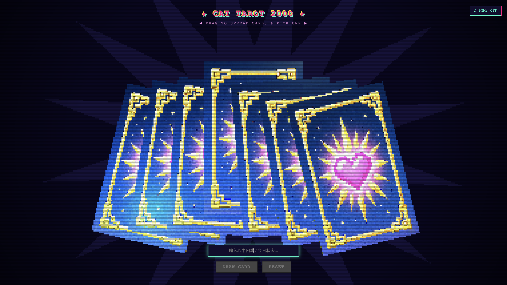
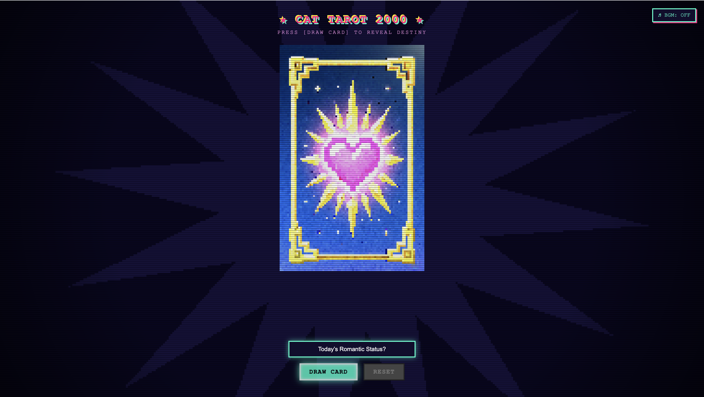
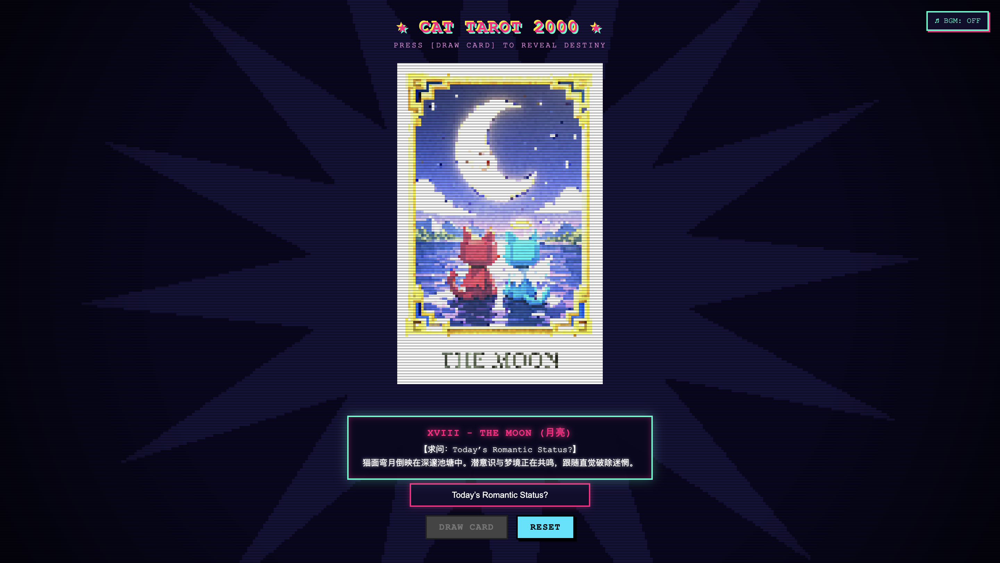

# ฅ^•ﻌ•^ฅ RETRO 3D CAT TAROT 2000 

> A web-based 3D tarot card reading experience blending late 90s PS1 / Y2K low-fidelity aesthetics with real-time Three.js physical interactions.

---

## Design Concept

This project explores the intersection between **digital nostalgia** and **healing interactive design**:
1. **Visual Aesthetics**: Inspired by early 2000s console graphics (PS1 / Nintendo 64 era CGI). By combining forced low-resolution canvas downsampling, disabled texture anti-aliasing (`NearestFilter`), faceted polygon cards with flat shading, and a simulated CRT scanline overlay, the interface faithfully captures the gritty yet charming lo-fi retro feel.
2. **Dual-Character Allegory**: Anchored around two original contrasting feline protagonists—the **Red Devil Cat** and the **Cyan Angel Cat**. Key Major Arcana cards (0 - The Fool, I - The Magician, VI - The Lovers, XVIII - The Moon) are reimagined into whimsical, low-poly fables that offer comfort and emotional resonance.
3. **Ritualistic Physicality**: Transcends conventional 2D flat button-clicking tarot web pages by introducing a simulated 3D physical shuffling and card-fanning ritual, providing spatial tactile feedback and user agency.

---

## Target Audience

* **Digital Nostalgia & Y2K Enthusiasts**: Gamers and creators passionate about early 2000s visual styles, vaporwave, retro gaming consoles, and pixel art.
* **Casual Tarot & Cat Lovers**: Individuals seeking brief, comforting emotional breaks, playful daily mindfulness readings, or light creative inspiration during busy routines.
* **Creative Technologists & Web Developers**: Designers and students interested in Three.js WebGL rendering, custom downsampled shaders, and interactive web mechanics.

---

## Key Interactions & Features

1. **Accordion Fan Spread & Horizontal Swipe**:
   - The session initiates with a 7-card deck arranged in a three-dimensional accordion fan spread.
   - **Pointer Drag / Touch Swipe**: Click and drag horizontally across the screen to glide through the deck with smooth linear interpolation (Lerp).
   - **Hover Feedback**: Hovering the cursor over individual cards elevates them upward with a gentle float effect.
2. **Card Picking & Centering**:
   - Clicking any desired card plays a crisp **8-bit audio blip**, causes all unselected cards to retreat off-screen, and slides the selected card to the upper-center of the viewport.
   - The `DRAW CARD` button illuminates with a pulsing ready-state animation.
3. **Inquiry Input, Flip Animation & Audio Feedback**:
   - Users can type their personal inquiry or query focus (e.g., *"Today's Energy?"*, *"Creative Direction"*) into the retro text input field.
   - Pressing `DRAW CARD` triggers a physical 180° Y-axis flip animation accompanied by a **synthesized mystic shimmer chord**, revealing one of the four handcrafted Major Arcana card faces (The Lovers, The Fool, The Magician, or The Moon).
   - The reading panel appears cleanly beneath the card without obscuring the artwork.
4. **Retro Sound System (BGM & Procedural SFX)**:
   - **Interactive BGM Toggle**: A retro `♫ BGM: OFF / ON` control situated at the top-right corner manages ambient background playback (`assets/bgm.m4a`), compliant with modern browser autoplay policies.
   - **Procedural Sound FX**: Built-in Web Audio API synthesizers deliver responsive 8-bit blips on button/card interactions and harmonic arpeggios upon card flips without latency.
5. **Interactive Reset Loop**:
   - Clicking `RESET` plays a tactile click sound, flips the card back to its gilded pixel-heart back, resets the selection state, and restores the fanned-out deck for repeated readings.

---

## How to Run Locally

Because the application utilizes Three.js to load external image textures (`assets/*.jpg`) and audio assets (`assets/bgm.m4a`), modern web browsers enforce Cross-Origin Resource Sharing (CORS) security restrictions when loading local files directly via `file://`. **Do not open `index.html` via double-click directly**.

---

## Known Limitations

1. **Browser Autoplay & AudioContext Gesture Policies:**:
   - Due to modern browser security and user privacy restrictions (Google Chrome & Apple Safari autoplay policies), audio streams and the Web Audio API cannot start playback automatically upon initial page load.
   - Users must explicitly interact with the interface (such as toggling the ♫ BGM button or clicking a card) to initialize the audio context and start sound playback.
2. **Audio Format and Codec Compatibility**:
   - The background music relies on the assets/bgm.m4a container (AAC codec), which is natively decoded across modern Chromium and WebKit browsers. However, legacy or minimalist Linux-based web environments lacking proprietary AAC decoders may require a fallback format such as standard MP3 or Ogg Vorbis.
3. **Mobile Touch Drag Calibration**:
   - While pointer events unify mouse and touch gestures, the drag coefficient and linear damping curves are primarily calibrated for desktop mouse dragging. On ultra-high-refresh-rate mobile touchscreens (120Hz ProMotion displays), rapid swipe gestures may feel slightly more sensitive.
4. **Client-Side Pseudo-Randomness**:
   - Card selection relies entirely on client-side pseudo-random number generation (Math.random()). It currently lacks advanced backend card-deck shuffling algorithms, such as the Fisher-Yates shuffle with state persistence or cooldown exclusion against immediate card repetition.
5. **Fixed Pixel Buffer Scaling on Extreme Viewports**:
   - The retro PS1 low-poly visual aesthetic is achieved by downsampling the 3D WebGL render target to a fixed resolution (LOW_RES_WIDTH = 380px) followed by nearest-neighbor upscaling. On ultra-wide monitors or rotated vertical mobile screens, the aspect ratio calculation may cause the letterbox framing to vary slightly.

## Screenshots & Live Demo

### 1. Visual Walkthrough

| 1. Accordion Fan Spread & BGM Toggle | 2. Centered Card Ready to Draw | 3. Flip Reveal & Reading Panel |
| :---: | :---: | :---: |
|  |  |  |

### 2. Live Demo URL
* **GitHub Pages**: `https://<your-github-username>.github.io/cat-tarot-interactive/`  
  *(Deployment Guide: Go to GitHub Repo -> Settings -> Pages -> Select `main` branch / root `/` -> Click Save)*

### 3. Screen Recording Demonstration
* **Video Demo**: [Watch / Download Demonstration Video (assets/demo_video.mp4)](assets/demo_video.mp4)  
  *(A short 15–30 second recording demonstrating deck swiping, BGM audio toggle, tactile 8-bit click feedback, question input, flip chord arpeggios, and deck reset)*